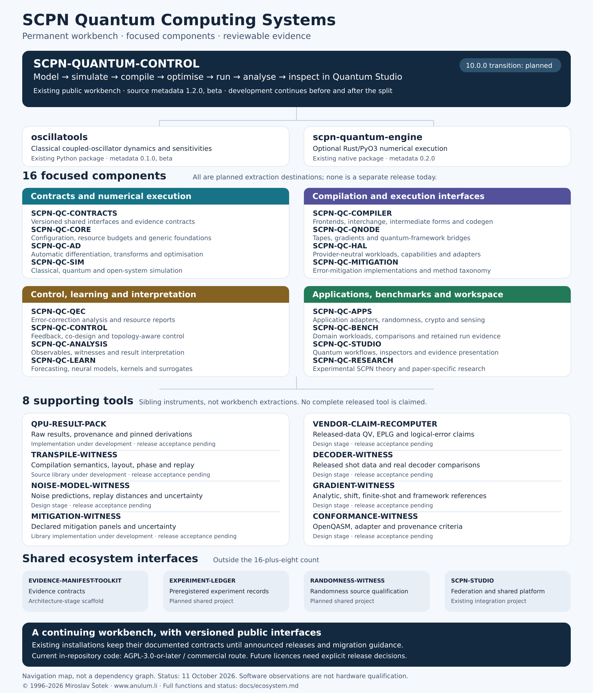

<!-- SPDX-License-Identifier: AGPL-3.0-or-later -->
<!-- Commercial license available -->
<!-- © Concepts 1996–2026 Miroslav Šotek. All rights reserved. -->
<!-- © Code 2020–2026 Miroslav Šotek. All rights reserved. -->
<!-- ORCID: 0009-0009-3560-0851 -->
<!-- Contact: www.anulum.li | protoscience@anulum.li -->
<!-- SCPN Quantum Control — Group and project map -->

# Quantum Group and Project Map

**SCPN-QUANTUM-CONTROL remains the permanent public development workbench**
for **SCPN Quantum Computing Systems**. It brings coupled-oscillator models,
classical and quantum simulation, compilation, differentiable computation,
provider integration, analysis and Quantum Studio into one connected workflow.
This breadth lets researchers compare execution paths and develop experiments
without assembling the whole integration themselves.

The current workbench package metadata is **1.2.0**, at beta maturity.
The planned **10.0.0 architecture transition** identifies **16 focused
components and eight supporting tools**. These 24 names identify
responsibilities; they do not announce 24 released packages. Substantial
development continues in the workbench before the transition, and integration
and product development continue there afterward.

[Open the full-size SVG](assets/scpn_quantum_group_map.svg),
[download PNG](assets/scpn_quantum_group_map.png), or
[download JPG](assets/scpn_quantum_group_map.jpg) (3200 × 3740 pixels).
Connecting lines group responsibilities for navigation. They do not specify
package dependencies, execution order or an extraction sequence.

For callable capabilities, inputs, outputs and backends, see the
[architecture map](architecture_map.md).

## What exists today

Status below reflects the source and architecture inventory of 11 October 2026.
An implementation under development is distinct from an available release;
successful software observations are distinct from qualified physical hardware.

| Project or package | Function | Current status |
| --- | --- | --- |
| [SCPN-QUANTUM-CONTROL](https://github.com/anulum/scpn-quantum-control) | Integrated modelling, simulation, compilation, gradients, control, provider workflows, analysis and Quantum Studio. | Existing repository and Python package; source metadata 1.2.0, beta. Capability and hardware claims retain their individual evidence boundaries. |
| [oscillatools](https://pypi.org/project/oscillatools/) | Classical coupled-phase-oscillator dynamics, observables, sensitivities and control-oriented numerical tools. | Separate Python package with source metadata 0.1.0, beta; maintained in this repository's `oscillatools/` tree. It is not one of the 16 planned extractions. |
| [scpn-quantum-engine](https://pypi.org/project/scpn-quantum-engine/) | Optional Rust/PyO3 numerical acceleration and native computation used by supported workbench paths. | Separate native package with source metadata 0.2.0; maintained in `scpn_quantum_engine/`. It remains a sibling package rather than being folded into SIM or AD. |
| QPU-RESULT-PACK | Preserve raw results and their provenance, derivations and reviewable presentation. | Implementation under development; complete public operations and release acceptance remain unfinished. |
| TRANSPILE-WITNESS | Retain scoped observations about compilation semantics, layout, global phase and replay. | Source library under development with genuine QCEC/PyZX execution paths; complete certificate operations and release qualification remain unfinished. |
| MITIGATION-WITNESS | Evaluate mitigation on declared measurement panels with retained inputs and uncertainty. | Local development repository with implemented library components; end-to-end witness operations and CLI remain unfinished. |
| EVIDENCE-MANIFEST-TOOLKIT | Shared evidence-manifest contracts and validation infrastructure. | Existing architecture-stage scaffold in the wider ecosystem. No released signing, verification or domain runtime package. |

The 16 component destinations remain planned extractions. Five further tools
below remain at the design stage. Reserved directories and settled names do
not establish installed runtime support or independent releases.

`QUANTUM_LAB` is a reserved workspace name, with no released product or
implementation role assigned by this map.

## Why focused components help

A team using classical oscillator dynamics should be able to select that
numerical package without a quantum-provider SDK. A gradient researcher needs
the derivative and framework contracts. A hardware team needs provider and
execution interfaces. A reviewer needs the original results, derivations and
their evidence boundaries. Focused components make these entry points and
installation requirements easier to understand.

The workbench remains the place to develop and exercise workflows spanning
these responsibilities. Before extraction, their implementations continue in
the integrated repository. After independently qualified component releases,
domain implementations belong to their focused owners and the workbench
integrates them through supported public interfaces.

## Sixteen planned component destinations

**Every destination in these tables is planned, not a separately released
component today.** Functions describe implementation ownership rather than a
promise that each current research path is stable or qualified.

### Contracts and numerical execution

| Destination | Function | Current status |
| --- | --- | --- |
| **SCPN-QC-CONTRACTS** | Versioned parameter, result, semantic and evidence interface contracts shared by components. | Planned extraction. |
| **SCPN-QC-CORE** | Configuration, logging, resource budgets and generic Kuramoto-XY problem foundations, separated from paper-specific research assumptions. | Planned extraction. |
| **SCPN-QC-AD** | Whole-program automatic differentiation, derivative transforms, batching, optimisation and explicit supported-path contracts. | Planned extraction. |
| **SCPN-QC-SIM** | Classical and quantum oscillator dynamics, XY/Kuramoto solvers, open-system simulation, tensor-network paths and co-simulation. | Planned extraction. |

### Compilation and execution interfaces

| Destination | Function | Current status |
| --- | --- | --- |
| **SCPN-QC-COMPILER** | Model and circuit frontends, intermediate representations, interchange and code generation. | Planned extraction. |
| **SCPN-QC-QNODE** | Quantum tapes, gradient execution and framework bridges for supported Qiskit, PennyLane, JAX, PyTorch and TensorFlow paths. | Planned extraction. |
| **SCPN-QC-HAL** | Provider-neutral workloads, capabilities, job/result contracts and optional provider adapters. | Planned extraction. |
| **SCPN-QC-MITIGATION** | Error-mitigation implementations and their method taxonomy. | Planned extraction; distinct from the MITIGATION-WITNESS evaluation tool. |

### Control, learning and interpretation

| Destination | Function | Current status |
| --- | --- | --- |
| **SCPN-QC-QEC** | Quantum error-correction analysis and fault-tolerant resource-reporting surfaces. | Planned extraction. |
| **SCPN-QC-CONTROL** | Feedback and co-design, chimera and topology-aware control, and DLA-constrained control paths. | Planned extraction. |
| **SCPN-QC-ANALYSIS** | Observables, synchronisation witnesses, result analysis and the open-data DLA-parity pathway. | Planned extraction. |
| **SCPN-QC-LEARN** | Forecasting, quantum neural models, surrogate models, kernels and variational learning paths. | Planned extraction. |

### Applications, benchmarks and workspace

| Destination | Function | Current status |
| --- | --- | --- |
| **SCPN-QC-APPS** | Domain application adapters, quantum randomness, cryptography and sensing workflows, with explicit claim boundaries. | Planned extraction. |
| **SCPN-QC-BENCH** | Workload-specific benchmark suites, comparison harnesses, campaign reproduction and retained run evidence. | Planned extraction. |
| **SCPN-QC-STUDIO** | Quantum Studio's visual workflows, inspectors and evidence presentation through the shared Studio platform contract. | Planned extraction. |
| **SCPN-QC-RESEARCH** | Experimental SCPN theory, paper-specific assumptions and research adapters whose contracts are not stable. | Planned extraction; retained research remains explicitly experimental. |

## Eight supporting tools

These are sibling tools, **not components extracted from the workbench**.
Each consumes declared source and evidence contracts. A tool reports the
scope it actually evaluated; it does not confer general hardware,
scientific or production qualification.

| Tool | Intended function | Current status |
| --- | --- | --- |
| **QPU-RESULT-PACK** | Capture or import raw results with explicit origin, retain freshness and completeness, bind deterministic derivations, and present the original evidence. | Implementation under development; complete release acceptance pending. |
| **TRANSPILE-WITNESS** | Compare supported circuit semantics through genuine QCEC/PyZX paths, retain unitary/global-phase/layout criteria, and distinguish captured compiler passes from declarations. | Source library under development; engine observations do not establish a universally qualified equivalence profile. |
| **NOISE-MODEL-WITNESS** | Compare model predictions and replay observations for the same circuit and shot identities, with uncertainty, shot floors, calibration epochs and declared tolerances. | Design stage; no released tool. |
| **MITIGATION-WITNESS** | Compare software/replay mitigation panels using public engines, a shared calibration window, independent known answers, uncertainty and predeclared criteria. | Library implementation under development; complete witness operations pending. |
| **VENDOR-CLAIM-RECOMPUTER** | Recompute released-data quantum-volume, error-per-layer-gate and logical-error claims against fixed definitions, original inputs and declared computation budgets. | Design stage; no released tool. |
| **DECODER-WITNESS** | Compare real decoder engines on released shot data with lossless adapters, declared noise conditions and uncertainty-aware reports. | Design stage; no released tool. |
| **GRADIENT-WITNESS** | Check software derivatives against declared analytic, parameter-shift and finite-difference references, including complex, finite-shot and cross-framework cases. | Design stage; no released tool. |
| **CONFORMANCE-WITNESS** | Check versioned OpenQASM 3, adapter behaviour, provenance fields and repository-evidence criteria against their normative clauses and actual entry points. | Design stage; no released tool. |

SCPN-QC-BENCH owns domain workloads and their run evidence.
VENDOR-CLAIM-RECOMPUTER evaluates a declared published claim against its
original protocol. SCPN-QC-MITIGATION owns mitigation implementations;
MITIGATION-WITNESS assesses declared use of those implementations. These
responsibilities remain distinct even when a workflow uses both.

## Shared ecosystem interfaces

The group participates in wider ecosystem contracts rather than duplicating
their infrastructure. These projects sit outside the 16-plus-eight count.

| Shared project | Quantum-facing responsibility | Current boundary |
| --- | --- | --- |
| **EVIDENCE-MANIFEST-TOOLKIT** | Portable evidence formats, canonical bytes, hashing, sealing and verification contracts. | Architecture-stage scaffold; dependent runtime qualification remains pending. |
| **EXPERIMENT-LEDGER** | Experiment lineage and preregistered campaign, shot and cost-budget records. | Planned shared project; design contributions do not establish a running ledger. |
| **RANDOMNESS-WITNESS** | Source qualification contracts for quantum/provider randomness adapters. | Planned shared project; an adapter design is not qualification of a physical source. |
| **SCPN-STUDIO** | Federation and evidence presentation through the shared Studio platform. | Existing shared integration project; the Quantum vertical remains part of the current workbench. |

## Continuity, compatibility and licensing

The 10.0.0 transition is a planned architecture milestone, **not an available
release or a migration deadline**. Extraction requires evidenced workbench
stability, reviewed public APIs and dependency boundaries, package acceptance,
compatibility checks and migration guides. Components can evolve under
supported version ranges; their versions need not match the workbench version.

Existing installations remain valid under their documented contracts until
announced component releases and migration guidance describe any changes.
Continue with the current [installation guide](installation.md),
[quickstart](quickstart.md), [API overview](api.md) and
[Quantum Studio guide](studio_workbench.md). This map does not change package
names or require users to migrate now.

The current workbench and its in-repository code remain under
**AGPL-3.0-or-later, with a commercial licence route**. The map does not
relicense a component or assign a future permissive or proprietary licence.
Any future component licensing decision must identify the actual released
files, dependencies and metadata and be announced for that component.
See the [licensing FAQ](licensing_faq.md).

For today's scientific and hardware scope, consult the
[hardware status ledger](hardware_status_ledger.md) and
[hardware result packs](hardware_result_packs.md). Software inventories,
simulator outputs and tool observations do not establish broad quantum
advantage, physical-device qualification or certification.
